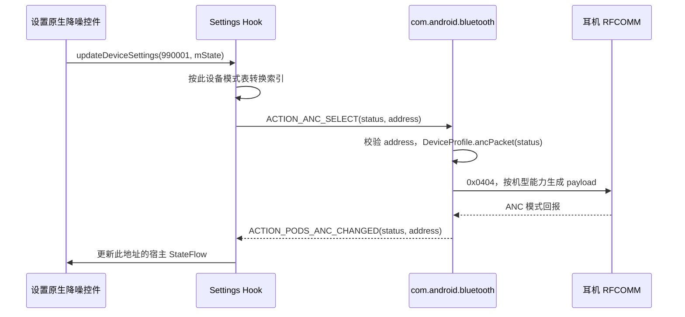

# Settings 17：OPPO 耳机标准详情页研究与修复记录

> **目标校正（2026-11-22）：本页描述的是 AOSP 风格标准详情页，不能作为小米新耳机专属页的实现说明。** 用户图二对应动态加载的耳机插件；入口、原生控件、机型配置器和数据契约见 [小米耳机插件定位记录](Settings_MIUI_Headset_Plugin_Research.md)。当前装机仍为标准页路径，不代表图二已接入。

日期：2026-11-21。源码分析基线：`3d13de29fe25cc6eb9d071969f71c87512c599ae`。

本文先说明指定设置 APK 的真实调用链，再记录本次代码修复与验证结果。静态证据、已修改代码和装机验证分开记录，不能把构建成功理解为耳机端全部功能已经验证。

## 1. 结论与分析范围

原实现的问题覆盖了入口、Context、模型类型、实时状态和 ANC 编码几层：即使详情数据 Hook 注册成功，也没有把国产版的默认详情页入口改到新版页面；即使手动打开新版页面，广播接收和降噪模型仍不完整。

本次修复采用设置自身的 `BluetoothDeviceDetailsFragment`、高级电量头部和原生 `SegmentedButtonPreference` 分段降噪控件。保留原生 XML 条目，把一个按设备地址隔离的降噪条目接入布局、实时状态流和指令回传三条链。耳机指令继续由现有蓝牙进程及设备配置档产生。

本次涉及：

- [SettingsDetailsHook.kt](../app/src/main/java/moe/chenxy/oppopods/hook/SettingsDetailsHook.kt)：OPPO 页面路由、生命周期、广播、电量适配与 Hook 注册。
- [SettingsDeviceSettingsBridge.kt](../app/src/main/java/moe/chenxy/oppopods/hook/SettingsDeviceSettingsBridge.kt)：目标进程的模型、状态流和原生控件适配。
- [SettingsDeviceState.kt](../app/src/main/java/moe/chenxy/oppopods/hook/SettingsDeviceState.kt)：状态确认、模式索引及电量汇总规则。
- [DeviceProfile.kt](../app/src/main/java/moe/chenxy/oppopods/pods/DeviceProfile.kt)：按配置档中的实际命令与能力生成可用 ANC 模式。
- [RfcommController.kt](../app/src/main/java/moe/chenxy/oppopods/pods/RfcommController.kt)：补发配置档、断连事件，以及 ANC 请求地址校验。
- [SettingsDeviceStateTest.kt](../app/src/test/java/moe/chenxy/oppopods/hook/SettingsDeviceStateTest.kt)：针对错位映射、未知状态、能力和电量的回归测试。

旧 [详情页研究笔记](Settings_Headset_Detail_Page_Analysis.md) 已标注为历史记录。旧版 `SettingsHeadsetHook` 已不是当前入口。

## 2. APK 身份与证据定位

分析输入为用户指定的 `设置_17.apk`，不修改该 APK。

| 项目 | 结果 |
|---|---|
| 包名 | `com.android.settings` |
| APK 大小 | 120,865,714 bytes |
| SHA-256 | `58c98b529ec396fff1ae52853cc809c2d0e3924a78e088e7ddc89bef49fb9f4e` |
| Manifest versionName / versionCode | `17` / `37` |
| compileSdk / minSdk / targetSdk | `37` / `37` / `37` |
| DEX 数量 | 12 |
| 主要页面所在 DEX | `classes2.dex` |
| SettingsLib 设备设置模型所在 DEX | `classes4.dex` |
| 协程 Flow 实现所在 DEX | `classes6.dex` |

版本信息来自 Manifest，而不是根据文件名推断。本次核验针对上述样本，不代表所有 Android 15、16 或其他 HyperOS 设置版本拥有相同私有接口。

以下方法定位使用 DexSQL 的 `file_id/method_idx`。本次输入中 `4=classes2.dex`、`6=classes4.dex`、`8=classes6.dex`；重新打开同一 APK 时也应先核对 `dex_files`，不要跨 APK 复用索引。

## 3. 为什么进不去新版页面

### 3.1 国产版列表的实际路由

关键方法是 `BluetoothSettings$8.onClick(View)`（`4/43793`）。设备旁设置按钮的主要路由为：

```text
按钮的 View.tag → CachedBluetoothDevice
  → 特殊 BLE/HID 设备入口检查
  → checkStartMiuiHeadset(cachedDevice)
       ├─ true：已启动 MIUI 专属耳机/插件页，结束
       └─ false：继续默认详情路由
            ├─ 国际版 + Slice 开关 + Pixel Buds UUID：BluetoothDeviceDetailsFragment
            ├─ 智能手环：BLE 专属页
            └─ 普通设备：DeviceProfilesSettings
```

关键 smali 分支：

- `:label_0095` 调用 `checkStartMiuiHeadset`；返回 true 则跳到方法末尾。
- `:label_0113` 国际版 Pixel Buds 分支补入 `device_address` 并启动新版 Fragment。
- `:label_0154` 普通设备最终启动 `DeviceProfilesSettings`。

因此，给 OPPO Hook `BluetoothDeviceDetailsFragment` 本身不会让国产版自动进入该页。旧文“通用兜底直接就是新版 Fragment”的说法不适用于这个样本。

`MiuiBluetoothSettings.checkStartMiuiHeadset`（`4/45272`）另会依据已缓存的厂商支持信息启动原生专属页或插件页。它与父类 `BluetoothSettings`（`4/43840`）共同构成需要适配的判定点。

### 3.2 本次入口修复

对 OPPO 设备拦截上述两个类的 `checkStartMiuiHeadset(CachedBluetoothDevice)`，通过原生 `MiuiUtils.startPreferencePanel(...)` 启动新版 Fragment，成功启动后返回 true，使原列表回调结束路由。

传入的 Bundle 同时包含：

```text
device_address = 当前设备地址
device         = 当前 BluetoothDevice Parcelable
```

其中 `device_address` 不能省略：`BluetoothDetailsConfigurableFragment.onAttach(Context)`（`4/42794`）依赖这个键查询本地 CachedBluetoothDevice；缺失或设备不在缓存中时会跳回连接设备页并结束当前页。只沿用旧页的 `device` 参数并不足够。

非 OPPO 设备原样执行系统路由。启动失败时记录 `OppoPods-Details` 日志并放行原逻辑。

## 4. 电量和耳机图的真实逻辑

### 4.1 头部可用性是 boolean → availability int 两个接口

```text
BluetoothUtils.isAdvancedDetailsHeader(BluetoothDevice): boolean
  → AdvancedBluetoothDetailsHeaderController.getAvailabilityStatus(): int
       true  → 0（可用）
       false → 2（不可用）
```

证据：`6/33165` 与 `4/41962`。原实现把前者当成返回 int 的方法并赋值 `0`，混淆了两个接口。修复后仅对 OPPO 返回 `true`，且注册前校验目标方法确实返回 boolean。

头部在首次展示时就会根据可用性隐藏/显示对应 Preference，因而必须在控制器首次可用性检查前识别设备；只在后续收到状态时刷新，不能保证重新显示已经隐藏的头部。

### 4.2 metadata 键的实际含义

| key | 含义 | 本次处理 |
|---|---|---|
| 5 | 整机图 URI | 不伪造 URI，保留原生逻辑 |
| 6 | Untethered/TWS 标识 | 对 OPPO 耳机返回 true |
| 7 / 8 / 9 | 左耳 / 右耳 / 盒图 URI | 保留原生读取与回退 |
| 10 / 11 / 12 | 左耳 / 右耳 / 盒电量 | 有当前快照时返回真实数值，未知为 -1 |
| 13 / 14 / 15 | 左耳 / 右耳 / 盒充电标志 | 从同一份有效电量快照读取 |
| 16 | 传统 Slice URI | 本次不通过 Slice 注入降噪 |
| 17 | 设备类型文本，例如 `Untethered Headset` | 原生也用于识别 TWS |
| 20–23 | 低电量阈值等 | 不是实际电量，不用作布局门控 |
| 25 | Fast Pair 自定义 XML 字段 | 原生设备配置端点和特殊电量策略会读取 |

原代码将 key 12 固定为 `50` 并解释为“双设备布局开关”，实际会制造 50% 的盒电量；本次已移除。三路布局由 TWS 身份等条件决定，不能靠伪造盒电量启动。

### 4.3 BatteryLevelsInfo 的构造与未知值

真实构造器为 `BatteryLevelsInfo(int left, int right, int case, int overall)`（`6/32936`）。原实现的构造顺序没有错，错在汇总策略和数据来源。

样本原生计算（`6/33273`）为：

```text
overall = 有效左右耳中的较小值
          若左右耳都未知，再使用盒电量
          全部未知时没有有效 overall
```

例如：左 90%、右 40%、盒 100%，overall 应为 40%，不是 100%。0% 是有效电量；断开的部件、未上报值和超出 0–100 的值使用 -1，不把 255 强行截成 100%。

本次同时适配 metadata 和 `CachedBluetoothDevice.getBatteryLevelsInfo()`。尚未收到模块快照时保留原生返回值；已明确断连时清除模块提供的实时数据。状态按设备地址存储，不再用一份全局电量同时覆盖所有已识别的 OPPO 设备，也不从磁盘恢复旧电量冒充当前连接的数据。

### 4.4 原生图片回退与刷新

`AdvancedBluetoothDetailsHeaderController.loadIcon(int, String, Consumer)`（`4/41992`）在没有 URI 时可回退到左耳、右耳、盒的通用 TWS 图标。无需先注入 OPPO 专属图片才能显示三路电量。

原生自定义 URI 分支先申请持久 URI 读权限，再读取 Bitmap；读取失败并不保证回退。本项目现有图片 Provider 不是可直接假定拥有 persistable grant 的来源，本次保留可靠的原生通用图标，不把图片权限问题混入电量修复。

刷新链路已核实：

```text
设置收到模块电量广播
  → 在主线程 CachedBluetoothDevice.dispatchAttributesChanged()（6/33263）
  → 已注册的头部 Callback.onDeviceAttributesChanged()（4/41994）
  → AdvancedBluetoothDetailsHeaderController.refresh()
  → 重新读取 BatteryLevelsInfo、充电标志并更新 UI
```

控制器的 `onStart`/`onStop`（`4/41995`、`4/41996`）负责注册/移除回调。仅改 metadata 并不保证样本里存在工作的 metadata listener，因此本次保留显式属性回调。

原生头部仍会检查设备是否连接和 busy 状态；断连时不强制伪装成连接。新 expressive 布局中，每个部件电量为 -1 时相应部分可隐藏。没有耳机实际分路上报时，不承诺凭空显示三路数值。

## 5. 降噪为什么不能只追加一个 MultiTogglePreference

### 5.1 原生有三层不同的数据

| 层 | 类型 | 内容 |
|---|---|---|
| 目录与布局 | `DeviceSettingsConfig` → `DeviceSettingItem` | settingId、provider 端点、内置 preference key、分组等 |
| 实时条目 | `DeviceSetting(settingId, preference, extras)` | 某个 ID 对应的 `MultiTogglePreference` 等具体控件模型 |
| 操作回传 | `DeviceSettingPreferenceState` | 用户选择的模式索引等新状态 |

原实现把 `MultiTogglePreference` 直接加入 `DeviceSettingsConfig.mainContentItems`，既没有包装成 `DeviceSettingItem`，也没有把自定义 `990001` 与实时数据流关联。即使反射构造器由于 List 的类型擦除允许构造，后续原生代码仍会把元素强转为 `DeviceSettingItem`。

证据：`DeviceSettingItem` 构造器 `6/34548`，配置构造器 `6/34611`，Repository 的转换 `6/34797`、`6/34798`，以及 update 遍历条目时的强转 `6/35030 :label_00cf`。

### 5.2 provider 与挂起函数的门槛

原生完整链路为：

```text
ViewModel.items（Deferred）
  → DeviceSettingRepositoryImpl.getDeviceSettingsConfig
  → DeviceSettingServiceConnection.getDeviceSettingsConfig(Continuation)
       → await isServiceEnabled
       → 等待必要 provider 就绪
       → await config
  → 将目录转换为 DeviceSettingLayout

AppProvidedItem(settingId)
  → Repository.getDeviceSetting(cachedDevice, settingId)
  → Connection.getDeviceSetting(settingId): Flow<DeviceSetting?>
  → Repository.toModel → 原生分段 Preference
```

配置服务端点来自 Fast Pair 自定义字段 `DEVICE_SETTINGS_CONFIG_PACKAGE_NAME`、`DEVICE_SETTINGS_CONFIG_CLASS`、`DEVICE_SETTINGS_CONFIG_ACTION`，并非“任意蓝牙设备都自动绑定一个可用 provider”。证据为 `6/34984`。

`getDeviceSettingsConfig`（`6/35022`）内部存在多个挂起点，原来的 after Hook 可能看到 `COROUTINE_SUSPENDED`，而非最终配置。把协程挂起标记当成配置替换会破坏恢复协议。即使只修成正确的目录元素，没有 provider 的实时 Flow 仍不能靠目录单独渲染工作中的降噪控件。

### 5.3 本次采用的模型接入方式

本次直接在已经核实的模型接口接入，避免为 OPPO 构造一套不存在的厂商服务：

1. 新版 Fragment `onViewCreated` 结束后，读取原生 `originalDisplayOrder`。
2. 在 `BluetoothDeviceDetailsViewModel.getNodes(MainFragment, Continuation)` 的 before Hook 中，同步返回原节点列表加 `AppProvidedItem(990001, false)` 的宿主 `DeviceSettingLayout`。
3. 保留所有内置条目及顺序，在 `action_buttons` 前插入降噪。重复构造先移除同 ID 自定义节点，防止重复出现。
4. 仅对 OPPO 的 `getDeviceSetting(990001)` 返回宿主 `MutableStateFlow<DeviceSetting>`，其他 settingId 保持原生行为。
5. 条目结构为 `DeviceSetting(990001, MultiTogglePreference(...), Bundle.EMPTY)`。
6. 收到该地址的 ANC、连接或配置档状态时更新该 Flow 的 value，原生 Repository 与 `SegmentedButtonPreference` 继续完成渲染。
7. 用户操作通过原生回调到 `updateDeviceSettings`，before Hook 读取真实 `MultiTogglePreferenceState.mState`，转换为模块模式并发送广播。

样本的 ANC 实际渲染方法为 `BluetoothDetailsConfigurableFragment.refreshAppProvidedPreference`（`4/42796 :label_0128–01aa`），创建的是 `SegmentedButtonPreference`。该页也包含用于其他条目或 Loading 的 ComposePreference，不能据此把 ANC 控件误判为 Compose。

本次不再 after 替换 provider 的挂起返回值。`getNodes` 自身虽是 suspend ABI，但在 before Hook 中完整同步返回合法模型是正常的非挂起完成方式，不需要修改 Continuation。

## 6. 模式映射与完整控制链

### 6.1 显示顺序与协议语义分开

[DeviceProfile.kt](../app/src/main/java/moe/chenxy/oppopods/pods/DeviceProfile.kt) 的控制器编码一直是 `1=关闭、2=降噪、3=通透、4=自适应`。原设置 Hook 的标签顺序却是“关闭、通透、降噪”，同时按 `index+1` 映射，导致通透与降噪反转。

修复后按实际配置档生成模式表，例如支持完整 ANC 时：

| 原生控件索引 | 标签 | 模块 status |
|---|---|---|
| 0 | 关闭 | 1 |
| 1 | 通透 | 3 |
| 2 | 降噪 | 2 |
| 3（可选） | 自适应 | 4 |

索引由该设备的模式表查找，不能再假设所有设备都是四项或用索引直接当协议值。没有实际命令的模式不显示；自适应同时要求配置档能力可见。明确没有两种以上 ANC 模式的设备移除降噪控件。配置档、连接状态或模式确认不完整时控件不可操作，越界索引不转换成“关闭”。

### 6.2 指令与回报



原生分段按钮的点击回调（`4/42752`）会先禁用全部按钮。本次加入每设备 5 秒的待确认超时：等待期间保留最近回报的选中态，匹配回报才解除 pending；无回报时重新发布最近已知状态并恢复操作，不把超时当成切换成功。无效索引、同值点击和发送失败也会重新发布状态，避免按钮永久锁死。

设置侧不再向自己发送伪造的 `ANC_CHANGED` 确认。实际选择命令仍复用现有 [RfcommController.kt](../app/src/main/java/moe/chenxy/oppopods/pods/RfcommController.kt) 和 [CapabilityProfileFactory.kt](../app/src/main/java/moe/chenxy/oppopods/pods/CapabilityProfileFactory.kt)，不在 Hook 中重复硬编码耳机协议包。

`updateDeviceSettings` 是 suspend Unit ABI，本次返回目标进程自己的 `kotlin.Unit.INSTANCE`。原实现返回 null 与该契约不符。模型、Flow、Unit 均由 Settings 的 ClassLoader 创建，避免混用模块打包的 Kotlin/协程类。

## 7. 广播与生命周期契约

### 7.1 广播方向

| 方向 | action 常量 | 主要 extras |
|---|---|---|
| Settings → Bluetooth | `ACTION_PODS_UI_INIT` | 请求当前快照 |
| Settings → Bluetooth | `ACTION_REFRESH_STATUS` | `allow_rfcomm_reconnect=false` |
| Settings → Bluetooth | `ACTION_ANC_SELECT` | `address`、`status` |
| Bluetooth → Settings | `ACTION_PODS_CONNECTED` | `address`/`device_address`、`device_name` |
| Bluetooth → Settings | `ACTION_PODS_BATTERY_CHANGED` | 地址及兼容电量 extras |
| Bluetooth → Settings | `ACTION_PODS_ANC_CHANGED` | 地址、`status` |
| Bluetooth → Settings | `ACTION_PODS_PROFILE_CHANGED` | 地址、`profile_json` |
| Bluetooth → Settings | `ACTION_PODS_DISCONNECTED` | 地址 |

方向均通过 `setPackage` 定向到目标包。完整字符串定义见 [OppoPodsAction.kt](../app/src/main/java/moe/chenxy/oppopods/utils/miuiStrongToast/data/OppoPodsAction.kt)。电量复用 [BatteryStatusIntent.kt](../app/src/main/java/moe/chenxy/oppopods/utils/miuiStrongToast/data/BatteryStatusIntent.kt)，同时兼容 Parcelable 和扁平 extras。

原生配置档广播此前只发模块 App，本次补到现有外发 helper；断连广播此前也只发 App，本次在清空 Context 前外发。ANC 指令增加可选地址匹配：新版设置带地址，其他设备的指令被拒绝；现有未带地址的旧发送端保持兼容。

### 7.2 Context 与刷新生命周期

原实现把 Fragment 当成 Context，首次进入时 `fragment as? Context` 必然失败，而保存的 Context 也未初始化，导致注册广播、请求快照与下发 ANC 全部无法启动。

本次从 `onAttach(Context)` 的真实参数和 `Fragment.getContext()` 获取 applicationContext。恢复页时注册接收器、请求快照并开始每 3 秒的状态查询。周期查询不重复请求整份 UI 快照，也不自动要求重连 RFCOMM。

离开页时停止轮询并注销接收器，清除电量/模式的实时确认；恢复页后等待新的快照，避免暂停期间错过断连而继续使用旧数据。销毁视图时移除会话与原布局引用。只为确认是 OPPO 的详情注册接收器，避免进入非 OPPO 页后留下接收回调。热重载时移除 Handler 和待确认超时回调、注销接收器、禁用旧 Flow 控件并释放缓存。

新一代 Hook 在主线程尝试接管已打开的详情 Fragment；页面下次恢复时也能重新取得已有 `originalDisplayOrder`。接管先调用 `constructLayout(original)` 取消旧 `uiJobs` 并移除旧生成控件，再请求附加 ANC 的布局以收集新 Flow。不能只请求相同布局，因为原生 `equals` 会使重排提前返回，留下旧收集器。

所有 Hook 继续通过 [HookContext.kt](../app/src/main/java/moe/chenxy/oppopods/hook/HookContext.kt) 注册，保留 API 102 稳定 hook ID。没有新增进程、权限、导出组件或第二个 Xposed 入口；[scope.list](../app/src/main/resources/META-INF/xposed/scope.list) 已声明 Settings 在内的四个目标包。

## 8. 修复前后对照

| 项目 | 修复前 | 本次处理 |
|---|---|---|
| 页面入口 | 只 Hook 新页数据，国产版仍走旧通用页 | OPPO 在真实路由点进入新版标准页 |
| 新页参数 | 缺少完整入口适配 | 补齐原生要求的 device_address |
| Context | Fragment 强转 Context 导致首次注册失败 | 使用生命周期 Context 参数 |
| 头部判定 | boolean 方法返回整数 0 | 严格匹配 boolean，OPPO 返回 true |
| 盒电量 | key 12 固定 50 | 真值或未知 -1 |
| 汇总电量 | 所有部件取最大值 | 有效耳机取最小值，无耳机才取盒 |
| 降噪模型 | preference 放入配置目录，缺实时条目 | 布局 AppProvidedItem + DeviceSetting + Flow |
| 协程处理 | after 可能覆盖挂起标记 | before 同步返回合法模型 |
| 降噪/通透 | 显示及指令编码互换 | 按设备支持模式表双向映射 |
| 指令目标 | 未限定地址 | 携带地址，Bluetooth 侧验证 |
| 回报同步 | 只刷新头部并自发确认 | 状态回报更新原生 Flow |
| 设备状态 | 一份全局缓存覆盖多设备 | 按地址隔离，暂停/断连清除确认 |
| 模式能力 | 固定三档且无法准确显示自适应 | 依据配置档提供实际模式 |
| 断连与配置档 | Settings 收不到完整外发事件 | 补齐现有广播桥 |

## 9. 兼容边界与人工回归项

- 本次适配已静态核对的 Settings 17 / SDK 37 私有接口。其他版本接口不匹配时记录日志并跳过相应 Hook，不宣称跨所有 HyperOS 版本通用。
- “APK 声明 Settings 作用域”与“LSPosed 用户实际启用了 Settings 作用域”是两回事；装机验证需检查后者。
- 初始识别仍依赖设备名/别名包含 OPPO 或已知地址。蓝牙进程现有 RFCOMM 启动仍依赖 OPPO 名称；其他品牌、改名且无历史记录的设备不在本次扩展范围。
- 本次新增原生降噪模式控制和三路电量。OPPO 专属图片、降噪深度、EQ、游戏模式等不在此页额外实现；保留系统原有的通用条目。
- 连接与 profile 快照并不等同于所有型号耳机都保证协议控制成功，仍取决于现有 RFCOMM 连接和机型配置的实际匹配。

回归应覆盖：从设备旁设置按钮进入新版页；无快照时禁用 ANC；收到状态后三路电量与充电符号；关闭/通透/降噪以及可选自适应切换；耳机外部操作后的反向同步；单耳、盒关闭与断连；切换另一副设备；返回再进入；非 OPPO 设备原入口；API 102 热重载后的回调释放。

## 10. 验证记录

本地已添加 12 项针对性回归测试，覆盖模式反转、自适应、能力缺失、未知/断连状态、越界索引、待确认与超时恢复、有效 0%、无效电量和 overall 策略。

执行命令：

```powershell
.\gradlew.bat :app:assembleDebug :app:testDebugUnitTest :app:lintDebug --console=plain
```

首轮在 Gradle 配置阶段因插件仓库 TLS 连接中断而失败，未进入源码编译。后续通过本机已有代理完成构建与测试。

| 检查 | 状态 |
|---|---|
| 指定 APK Manifest / DEX / 关键签名静态核验 | 已完成 |
| 标准详情页模型链路独立静态审查 | 已完成 |
| assembleDebug | 通过，生成 versionCode 17 / versionName 1.5.1 |
| testDebugUnitTest | 66 项通过，其中本次新增 12 项 |
| lintDebug | 报告 5 处既有 Compose 配置读取错误；已做最小修复，复查过程中用户中止，未记为通过 |
| 装机 | 按用户授权保留数据覆盖安装成功，四个作用域已确认 |
| 页面结果 | 用户图一确认标准页入口、三路电量与模式控件已出现；用户随后明确目标为图二的小米专属页，因此不能记为目标 UI 已完成 |

安装时本地 Debug 签名与旧发布签名不同；用户明确要求直接覆盖并说明设备已有核心破解，实际 `adb install -r -t` 返回 Success，没有卸载旧应用。后续目标页定位参见 [小米耳机插件研究](Settings_MIUI_Headset_Plugin_Research.md)。

## 附录：关键反编译定位

| file_id/method_idx | 方法 | 支持的结论 |
|---|---|---|
| 4/43793 | `BluetoothSettings$8.onClick(View)` | 国产版普通设备进入 DeviceProfilesSettings |
| 4/45272 | `MiuiBluetoothSettings.checkStartMiuiHeadset(CachedBluetoothDevice)` | MIUI 专属页与插件页路由 |
| 4/12962 | `MiuiUtils.startPreferencePanel(Activity,String,Bundle,int,CharSequence,Fragment,int)` | 本次复用的原生页面启动接口 |
| 4/42794 | `BluetoothDetailsConfigurableFragment.onAttach(Context)` | device_address 与缓存设备要求 |
| 4/42795 | `BluetoothDetailsConfigurableFragment.onViewCreated(View,Bundle)` | originalDisplayOrder 初始化 |
| 4/47463 | `BluetoothDeviceDetailsViewModel.getNodes(FragmentTypeModel,Continuation)` | 主/更多页面读取模型的挂起接口 |
| 4/42778 | `BluetoothDetailsConfigurableFragment.constructLayout(DeviceSettingLayout)` | 未列入布局的内置条目会移入不可见组 |
| 4/42797 | `BluetoothDetailsConfigurableFragment.requestUpdateLayout(FragmentTypeModel)` | 本次触发原生布局更新的入口 |
| 6/35060 | `AppProvidedItem(int,boolean)` | 自定义布局节点的真实构造器 |
| 6/35092 | `DeviceSettingLayout(List)` | 原生布局模型 |
| 6/35021 | `DeviceSettingServiceConnection.getDeviceSetting(int)` | 实时条目 Flow 的入口 |
| 6/34790 | `DeviceSettingRepositoryImpl.getDeviceSetting(CachedBluetoothDevice,int)` | 连接层 Flow 到 Repository 转换 |
| 6/34800 | `DeviceSettingRepositoryImpl.toModel(DeviceSetting,CachedBluetoothDevice,Connection)` | MultiToggle 模型及点击回调转换 |
| 6/35030 | `DeviceSettingServiceConnection.updateDeviceSettings(int,PreferenceState,Continuation)` | provider 回传与 suspend Unit 契约 |
| 6/34450 | `DeviceSetting(int,DeviceSettingPreference,Bundle)` | 具体控件条目包装 |
| 6/34697 | `MultiTogglePreference(String,List,int,boolean,boolean,Bundle)` | 选中索引、active、allowed-changing 字段 |
| 6/34728 | `ToggleInfo(String,Bitmap,Bundle)` | 每档标签与图标 |
| 8/20975 | `StateFlowKt.MutableStateFlow(Object)` | 宿主 Flow 工厂 |
| 6/33165 | `BluetoothUtils.isAdvancedDetailsHeader(BluetoothDevice): boolean` | 头部判定真实返回类型 |
| 4/41962 | `AdvancedBluetoothDetailsHeaderController.getAvailabilityStatus(): int` | 可用性 0 / 2 转换 |
| 6/32936 | `BatteryLevelsInfo(int,int,int,int)` | left/right/case/overall 顺序 |
| 6/33273 | `CachedBluetoothDevice` 的 metadata 电量读取方法 | overall 与无数据 fallback |
| 6/33263 | `CachedBluetoothDevice.dispatchAttributesChanged()` | 属性变更回调 |
| 4/41992 | `AdvancedBluetoothDetailsHeaderController.loadIcon(int,String,Consumer)` | 无 URI 时的原生通用图回退 |
| 6/34984 | `tryGetEndpointFromMetadata$2.invokeSuspend(Object)` | Fast Pair 中的三个配置服务端点字段 |
